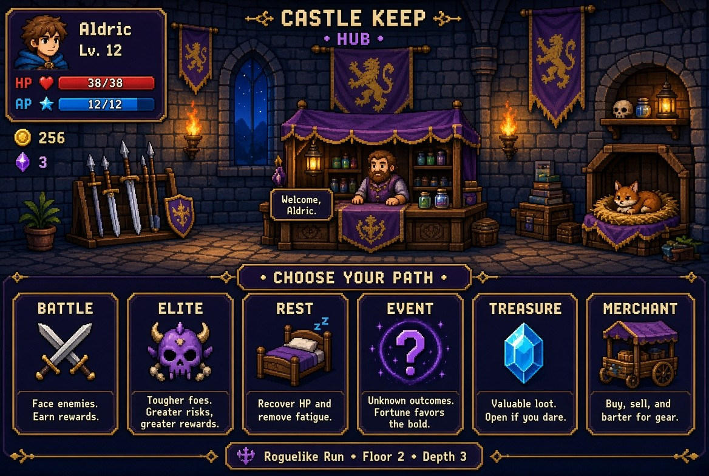

# SRM Piksel

**Premium turn-based pixel roguelike** — bangun silsilah hero, kuasai timing combat, evolusi Super & Ultra class.

## Fitur komersial

| Sistem | Detail |
|--------|--------|
| **Race** | 8 race + passive unik |
| **Class** | 6 base → 18 Super → Ultra awaken |
| **Talent** | 8 talent build-defining |
| **Combat** | Timing Perfect/Good, Guard, Skills, Burn/Poison, Crit |
| **Pets** | 5 companion dengan efek pasif |
| **Path** | Battle · Elite · Rest · Event · Treasure · Merchant · Boss |
| **Gear** | Weapon / Armor / Ring (multi-tier) |
| **Meta** | Bloodline Rank (persisten antar run) |
| **Save** | localStorage offline |
| **Art** | Full pixel asset pack (class, race, pet, item, boss, hub) |
| **Kode** | SRM · PIKSEL · LINEAGE · BLOOD · PETS |

## Cara main

1. Extract ZIP — pastikan `index.html` dan semua `img-*.jpg` **satu folder**
2. Buka `index.html` di browser modern
3. Atau deploy ke **GitHub Pages** (upload seluruh folder)

## Progress

- **Floor 5** → unlock Super Class
- **Level 12 + Super** → Ultra Awaken (+18% stats)
- **Boss** setiap kelipatan 5 → naik Bloodline Rank

## Keyboard combat

`1` Attack · `2` / `3` Skill · `G` Guard · `M` Meditate · `P` Potion · `Space` Timing

## Tech

- Single-page HTML5 + CSS3 + vanilla JS
- Zero dependency · offline-first
- Mobile responsive
- Pixel art assets included

---

**SRM Piksel** v1.0 Commercial Build  
Inspired by Pixel Lineage (Silsilah Piksel) roguelike systems.
